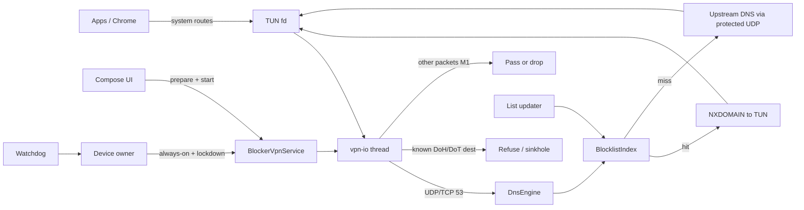
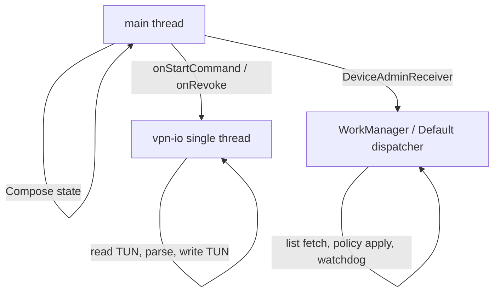
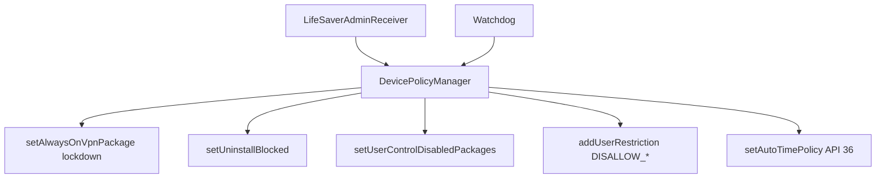
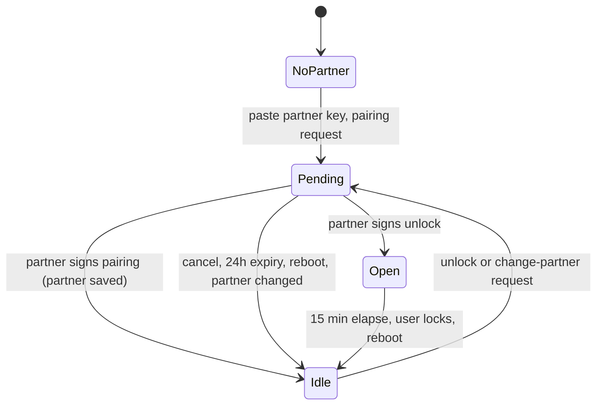

# LifeSaver architecture

Smallest split that matches the threat model. Four modules. No extra process, no cloud backend we operate, no Play services dependency required for blocking.

## Modules

```
:app        Compose UI, Application, notification channels, debug/release wiring
:vpn        VpnService, TUN loop, DNS parse/forward/sinkhole
:blocklist  List parse, suffix index, snapshots, (later) signed update
:policy     DeviceAdminReceiver, DevicePolicyManager, restrictions, watchdog, unlock
```

`:app` depends on the other three. `:vpn` depends on `:blocklist` and `:app`-free `:policy` interfaces only (status + "is hardened"). `:policy` does not parse packets. `:blocklist` has no Android VPN types.

M0 ships `:app`. M1 adds `:vpn` with an in-module hardcoded list. M2 extracts `:blocklist` (hosts parser, `BlocklistIndex`, SharedPreferences overrides; bundled list in its assets). M8 adds `:policy`.

Suggested package root: `app.lifesaver` (final name is a Step 2 question).

## Runtime pieces

| Piece | Process / thread | Role |
| --- | --- | --- |
| `MainActivity` + Compose | main | Status, consent, unlock request, partner QR (once) |
| `BlockerVpnService` | main for lifecycle; `vpn-io` for packets | TUN, foreground notification, always-on entry point |
| `DnsEngine` | `vpn-io` | Parse DNS, lookup, build NXDOMAIN or forward |
| `BlocklistIndex` | loaded on vpn-io or a one-shot worker | Immutable snapshot, lock-free reads |
| `LifeSaverAdminReceiver` | main (keep work short) | Device-owner callbacks |
| `PolicyApplier` | background (`Dispatchers.IO`) | `setAlwaysOnVpnPackage`, restrictions |
| `Watchdog` | WorkManager / `DeviceAdminReceiver` | Re-apply missing policy |
| `UnlockEngine` | main (state), IO (network) | Partner-approved unlock, monotonic window |
| `EventLog` | IO | Local events only |

## Data flow



### DNS path (the actual blocker)

1. `VpnService.Builder` assigns the TUN an IPv4 and IPv6 address, `addDnsServer()` to a fake resolver on the TUN (for example `10.0.0.1` and `fd00:1::1`), and adds routes for at least those DNS addresses. M1 may use a default route if that is the only reliable way to receive DNS on API 36/37 — **verify on the emulator**; partial routes have failed on some versions (`unverified` until M1).
2. The `vpn-io` thread reads IP packets from the `ParcelFileDescriptor`.
3. IPv4/IPv6 + UDP (and TCP if implemented) port 53 are parsed just far enough to get QNAME. No full TCP stack in M1: TCP/53 can be refused with RST or dropped.
4. Name is lowercased, trailing dot stripped, matched with suffix rules (`foo.blocked.example` matches `blocked.example`).
5. Hit: write a DNS response with `NXDOMAIN` (or `0.0.0.0` / `::` if we find a compatibility reason; prefer NXDOMAIN).
6. Miss: send the query to the current network DNS on a `protect()`-ed socket; write the response back onto the TUN.

Upstream DNS must use `VpnService.protect()` so the query does not re-enter the TUN.

### What we deliberately do not do

- No userspace NAT of all TCP/UDP in M1–M3 unless emulator tests show we must take a default route **and** forward everything. If we must forward, keep it a thin IP forwarder, not a proxy.
- No TLS interception.
- No reading of HTTP URLs or SNI as a block signal in v1 (SNI filtering is a later, optional discussion; it is more code and still misses ECH).

## Threading



Rules:

- Only `vpn-io` touches the TUN fd.
- `BlocklistIndex` is swapped atomically (`volatile` / immutable reference). Reloads build a new index, then publish.
- `DeviceAdminReceiver` callbacks stay on main and hand off to `PolicyApplier`.
- No `runBlocking` on main. No DNS parse on main.

## VpnService lifecycle

Documented system behavior ([VPN guide](https://developer.android.com/develop/connectivity/vpn), updated 2026-02-26):

1. UI or always-on calls `startService` / the system starts us.
2. `onStartCommand` → `startForeground` immediately (Android 8+ kills background VPN apps that do not).
3. `Builder.establish()` returns the TUN or `null` if consent was revoked.
4. Always-on: system restarts us after reboot and app upgrade. We must persist config and not require a tap.
5. `onRevoke()`: close the fd. Another interface is already routing traffic. Do not assume main thread.

Foreground type: `systemExempted` + `FOREGROUND_SERVICE_SYSTEM_EXEMPTED`. Official allowlist includes **active VPN apps** and **device owner** ([FGS types, Android 14](https://developer.android.com/about/versions/14/changes/fgs-types-required)). Do **not** use `dataSync` — Android 15 gives that type a 6-hour/24-hour cap and blocks starting it from `BOOT_COMPLETED`.

## Policy / device owner



`DeviceAdminReceiver` is still the published admin component ([reference](https://developer.android.com/reference/android/app/admin/DeviceAdminReceiver)). Legacy *device admin* policies (the old user-toggleable admin) are the wrong mode. We need **device owner**, which can only be set on an unprovisioned device.

Order matters: set always-on VPN **before** `DISALLOW_CONFIG_VPN`. That restriction prevents VPNs from starting, except always-on VPNs created by the owner (API 24+). From API 31 it also clears a user-configured VPN.

## Unlock

Signed partner approval, no fallback. Full rules in [UNLOCK.md](UNLOCK.md).



`UnlockEngine` (in `:policy`) stores the partner's **public** key and, for a pending request, a random request id, a random relay topic and (for pairing and partner changes) the candidate key. Two timers (`pending*`, `window*`) each carry `Until`, `At` and `Boot`; a timer is valid only while the boot count is unchanged and `elapsedRealtime` has not gone backwards. The wall clock is never read. While `Open`, `BlockerVpnService` forwards DNS without blocking and the content guard stays quiet. Nothing is stopped or restarted.

While `Pending`, the service's `approval-poll` thread asks the relay for messages on the request's topic every 5 seconds and verifies each `purpose.requestId.signature` with ECDSA P-256 (`PartnerCrypto`). Network calls never run under the engine lock. The relay carries only public data. The partner signs on the approve page (WebCrypto) or in the app (`PartnerKeys`).

## Persistence

| Data | Where | Why |
| --- | --- | --- |
| Bundled blocklist | APK assets | Offline first run |
| Current snapshot | `filesDir` (atomic replace) | Survives updates of the APK asset |
| Allow/deny overrides | SharedPreferences (M2) | Tiny |
| Event log | Room, capped | Local audit |
| Unlock state (partner public key, request id, timers) | SharedPreferences `unlock` | Nothing secret. The partner's private key never touches this phone |
| Partner's own key (only on the partner's phone, when they use the app) | SharedPreferences `partner` | Private key stays on the partner's device |
| Ed25519 public key | APK | Update verify |

No account. Auto Backup is off for the whole app.

## Logging (what we do not store)

Log: `vpn_up`, `vpn_down`, `unlock_requested`, `unlock_granted`, `unlock_denied`, `list_update_ok/fail`, `policy_ok`, `policy_reapplied`, daily `blocked_count`.

Do not log: QNAME, URL, destination IP, package id of the requesting app, page titles, screenshots.

Reason: a local diary of blocked sites is itself a trigger and a privacy problem if a backup or adb pull happens before debugging is locked. Aggregate counts are enough to see that the engine is alive.

## Battery and performance

DNS-only I/O is a few small packets per page load. One dedicated thread blocked on `read()` is the usual ToyVPN pattern ([AOSP ToyVPN](https://developer.android.com/develop/connectivity/vpn) points at it).

Cost grows if we take `0.0.0.0/0` + `::/0` and forward every packet. M1 should try DNS-only routes first. If Chrome on API 37 still uses Private DNS or bypasses our DNS, M3/M9 handle that; do not silently become a full-traffic VPN without measuring.

**Unverified until M1/M3 on the emulator:** CPU %, always-on drain vs no-VPN, and whether a DNS-only route receives queries on this system image.

## Build flavors

| Flavor | Use |
| --- | --- |
| `debug` | Extra logcat; allow/remove-block overrides, only inside an unlock window; `-PntfyBase` test relay |
| `hardened` | No allow overrides, device-owner assumed |

Both share the same engine. There is no Stop button in either, and no debug unlock.
